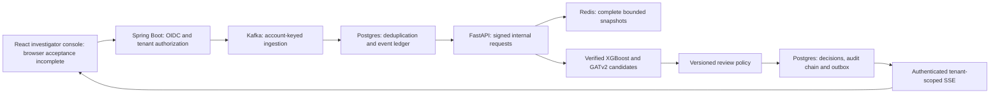

# MuleNet

MuleNet is a research platform for evaluating graph-based money-mule detection
and investigator review workflows. It combines Spring Boot, FastAPI, React,
Kafka, Postgres, Redis and optional Keycloak OIDC. Current evidence comes from
simulated datasets, not bank deployments. The project is under active hardening
and is **not approved for production decisions**.

## Current Status

Shared as-of features, future-only labels, real message-passing models, verified
model bundles and an authenticated, audited backend are implemented and tested.
The replacement investigator console uses the authenticated platform API, with
no substitute decision data. Its browser acceptance is not yet green: the latest
run passes desktop workflows but fails mobile login. Full-network AMLworld
evaluation, full deployment-scale load testing and clean-checkout acceptance remain
unfinished. Local measured boundaries are detailed below. The
[completion checklist](docs/DOD_CHECKLIST.md) is authoritative.

Security acceptance is **failed**, not waived: licensed Spring patches and
unfixed distribution advisories remain open. A credential found in a retired
deployment file must also be revoked at its provider. See
[security exceptions](docs/SECURITY_EXCEPTIONS.md).

The ML service exposes authenticated, tenant-isolated drift signals tied to a
verified training reference. Insufficient windows are explicitly not ready;
drift requests review, never an automatic hold or model promotion. Older bundles
without that reference require the [documented upgrade](docs/RUNBOOK.md).

## Architecture



SOFT_HOLD is a time-limited internal review state, not a bank-account freeze.
See [platform contracts](docs/PLATFORM_CONTRACT.md) and the
[baseline architecture audit](docs/ARCHITECTURE.md).

## Development

Use the Python version in `.python-version` and dependencies in `uv.lock`.
Install uv, Node/npm, Java/Maven and Docker first. Do not deploy placeholder
secrets or expose the ML service.

```sh
uv sync --frozen --all-groups
uv run --frozen --all-groups python scripts/bootstrap_secrets.py
uv run --frozen --all-groups python scripts/record_tests.py --phase local
uv run --frozen --all-groups python scripts/eval_smoke.py --allow-synthetic
```

The smoke check trains fresh seeded models and compares generated results against
reviewed golden evidence. It is a regression check, not a banking-effectiveness
claim. Read [data licensing](data/README.md), [security setup](docs/SECURITY_SETUP.md)
and [the runbook](docs/RUNBOOK.md) before starting services. A verified one-command
full-stack demo is still pending UI and deployment checks.

## Evaluation

Tables are generated by `scripts/render_readme_metrics.py`; do not edit values.
Thresholds are selected on validation only. Report files retain the full protocol.

<!-- METRICS:START -->
All datasets below are simulated. Values include 95% confidence intervals.

| Dataset | Split | Model | Test rows | VAL threshold | PR-AUC | Recall | FPR |
|---|---|---|---:|---:|---|---|---|
| Local simulator | temporal | tabular_graph | 180 | 0.2500 | 0.1360 [0.0763, 0.3194] | 0.0000 [0.0000, 0.3694] exact | 0.0000 [0.0000, 0.0212] exact |
| Local simulator | entity | tabular_graph | 340 | 0.2857 | 0.0924 [0.0644, 0.1915] | 0.0000 [0.0000, 0.1482] exact | 0.0000 [0.0000, 0.0116] exact |
| PaySim (pre-transfer) | temporal | XGBoost | 130116 | 0.5000 | 0.8952 [0.8837, 0.9061] | 0.7446 [0.7229, 0.7656] | 0.0011 [0.0009, 0.0012] |

Simulator operating point: VAL only; maximize recall at empirical FPR <= 0.001.
The displayed threshold is rounded; serving uses the full-precision artifact value.
<!-- METRICS:END -->

PaySim is simulated transaction classification, not topology validation. Its
post-transfer diagnostic is not deployable pre-transfer evidence. The account
simulator forecasts a different outcome and cannot be directly ranked against
PaySim. Full-network AMLworld performance is unmeasured; bounded diagnostic
cohorts are not statistically estimable.

Intervals use a row bootstrap, ignoring account/ring dependence; additional
exact binomial bounds expose degenerate operating-point uncertainty. The GNN
did not earn the default path on the recorded validation runs. XGBoost with
graph features remains selected. No real financial benefit has been measured.

## Latency

<!-- LATENCY:START -->
Model-only, single-request wall-clock timings in milliseconds.

| Load | Requests | Concurrency | p50 | p95 | p99 |
|---|---:|---:|---:|---:|---:|
| steady | 200 | 1 | 0.8599 | 1.2082 | 1.3811 |
| burst | 200 | 8 | 6.0206 | 10.1323 | 17.3515 |

Actual-network local stack; individual request timings with 95% bootstrap intervals (ms).

| Boundary | Load | Requests | Concurrency | p50 | p95 | p99 |
|---|---|---:|---:|---|---|---|
| ML HTTP | steady | 100 | 1 | 30.5563 [29.9478, 31.3182] | 36.2333 [34.0417, 38.6967] | 38.9715 [36.2267, 39.0402] |
| ML HTTP | burst | 100 | 8 | 210.5032 [200.8717, 218.2892] | 402.7572 [283.2599, 412.0782] | 418.7650 [384.8617, 421.1970] |
| Kafka producer-to-SSE | steady | 100 | 1 | 499.9703 [499.7349, 500.2143] | 503.9326 [502.0501, 525.7005] | 750.3070 [503.9538, 752.9088] |
| Kafka producer-to-SSE | burst | 100 | 8 | 1141.9945 [1016.4361, 1266.7175] | 1275.9435 [1273.5476, 1520.8901] | 1524.0605 [1278.3325, 1525.1855] |

Synthetic hot-account traffic on one local stack, not a production SLO. The neural path was not selected or measured.
Kafka timing starts before producer send and ends after receipt of both committed decisions over HTTP SSE; ingestion REST/outbox is excluded.
See [raw network benchmark](reports/latency-pipeline.json) for identities, sample timings, precise boundaries and limitations.
<!-- LATENCY:END -->

Model-only timings exclude feature extraction, Redis, HTTP, Kafka, policy and
SSE. Any separately reported network benchmark has its own explicit boundaries.
Neither experiment establishes deployment-scale latency or throughput guarantees.
The model-only and network experiments use different bundles and payloads;
their JSON reports record the identities. Do not compare them as the same workload.

## Simulated Versus Implemented

| Surface | Status |
|---|---|
| PaySim, AMLworld and local typology generator | Simulated data |
| I4C/NCRP watchlist | Simulated I4C/NCRP-style adapter; no government access |
| Bank freeze or victim recovery | Not implemented or measured |
| Models | Actual XGBoost, Isolation Forest and PyG message passing |
| Kafka, persistence, cache and authenticated scoring | Actual local integration tests |
| STR export | Draft/template evidence JSON, not a regulatory filing |
| Artifacts | Hash/schema checked; publisher attestation absent |
| Frontend | Legacy view awaiting API and workflow migration |

## Documentation

- [Evidence audit](docs/AUDIT.md), [decisions](docs/DECISIONS.md), [execution log](docs/CHANGELOG_AGENT.md)
- [Model card](docs/MODEL_CARD.md), [feature contract](docs/FEATURE_CONTRACT.md), [runbook](docs/RUNBOOK.md)
- [Threat model](docs/THREAT_MODEL.md), [privacy](docs/PRIVACY.md), [security exceptions](docs/SECURITY_EXCEPTIONS.md)

Roadmap: primary topology evaluation, full-path load measurements, observability
and hosted CI, investigator UI migration, independently reviewed deployment
security. Historical pitch documents and unsafe launchers have been retired.

## License

Project code is [MIT licensed](LICENSE), with NoString affiliation. Benchmarks
have separate supplier terms; raw datasets are not committed here.
