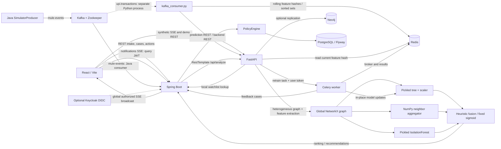

# Architecture: Observed Baseline

Baseline: `85b10e6e5df87f6ce7f44bb2ea6e12e66d65cf8a`. This diagram describes
existing code, not an assertion of successful deployment or production readiness.

## Modules and Entrypoints

| Module | Entrypoint | State / observations |
|---|---|---|
| Backend | `backend/.../ApiApplication.java`, Maven / Spring Boot | Intake, cases, actions, thresholds, SSE, local auth or optional OIDC |
| ML | `ml_service/main.py`, Uvicorn | Imports stateful graph, lazily loads unsafe legacy models; token presence is not validation |
| Graph | `graph_builder.py`, `graph_analytics.py`, `recovery_engine.py` | Global DiGraph and transaction list, optional Neo4j, no bounded adjacency retrieval |
| Python stream worker | `ml_service/kafka_consumer.py` | Separate process; subscribes to upi.transactions, unlike Java consumer |
| Retraining worker | `celery -A celery_app.celery worker` | Redis broker/result store; user-token forwarding; active model mutation |
| Training | `training/train_and_test.py`, `train.py`, notebook | Divergent synthetic/data and feature paths; random heldout split |
| Evaluation | `training/generate_metrics.py`, `external_benchmark.py`, `metrics_evaluator.py` | Different data/protocols; no single manifest-backed evaluation command |
| Frontend | `frontend/src/main.jsx`, `App.jsx` | Local token storage; Common.jsx configures backend/ML origins separately |
| Orchestration | `docker-compose.yml`, `run_all.bat`, `render.yaml` | Postgres, Redis, Zookeeper/Kafka, Neo4j, Keycloak, backend, ML, Celery, frontend |
| Existing CI | `.github/workflows/python-package-conda.yml` | Conda dependency ranges, flake8 and broad pytest only |

## HTTP and SSE Inventory

Spring controller prefixes and method mappings are authoritative, not README:

- `/api/auth/login`; `/api/health`, `/api/readiness`.
- `POST /api/intake`, `POST /api/prediction`, `POST /api/demo/seed`.
- `/api/cases`: list/detail, `/{caseId}/actions`, `/{caseId}/status`,
  `/{caseId}/assign`, `/{caseId}/comments`, `/feedback`, `/export/csv`,
  `/stats/summary`, `/policy/thresholds` (the latter are under cases).
- `/api/external/watchlist`, `/watchlist/all`, `/watchlist/add`, `/watchlist/remove/{id}`.
- `/api/audit-logs`, `/api/audit-logs/export/csv`, `/api/users`, `/api/users/{username}/status`.
- Spring SSE: `/api/notifications/subscribe` and `/api/stream/subscribe`; controller
  role guards exist but subscriber storage has no tenant/assignment scope.
- ML: `/`, `/api/health`, `/api/models`, `/api/analyze`, `/api/predict`,
  `/api/batch-predict`, `/api/external-check`, `/api/graph/query`,
  `/api/governance/retrain`, `/api/stream/next`, `/api/stream/subscribe`.
- ML demos: `/api/v1/detect`, `/api/v1/detect/advanced`, `/api/v1/metrics`,
  `/api/v1/audit/{run_id}`, `/api/v1/failure-demo`. These generate graphs rather
  than evaluate persisted real decisions. The advanced ensemble omits graph edges.

## Persistence and Model Loads

Flyway migrations under `backend/src/main/resources/db/migration/` are the running
schema authority; `database/schema.sql` is a separate, drifting schema document.
Tables include accounts, transactions, devices, locations, predictions, alerts,
cases, investigators, audit_logs, threat_intelligence, policy_configurations,
case_comments, complaints and investigator_actions. The initial transaction
schema has NOT NULL sender/receiver foreign keys with ON DELETE SET NULL; deletion
semantics need integration coverage. Monetary types differ between the schema
document and Flyway. There is no tenant key, policy-version ledger, feedback
quality table, transactional outbox, audit hash chain or model manifest in the
observed migrations. Model response JSON is retained on cases.

`ml_models.py` loads `trained_models/fast_path_model.pkl`,
`fast_path_scaler.pkl`, `gnn_weights.pkl`, `isolation_forest.pkl`. Absent artifacts
trigger synthetic training; some load failures also retrain. They are not verified
against hashes or a feature schema. Training writes the same locations. The
offline GNN trainer is a different forward pass from the serving implementation.

`GLOBAL_GRAPH`, `GLOBAL_TXNS`, and complaint uplifts live in a Python process.
Graph edges overwrite repeated sender/receiver pairs. Redis stores rolling
aggregates, not the specified bounded, versioned adjacency cache. Neo4j replication
is best effort, not the authoritative serving source. Multiple Uvicorn workers
would not share Python state or the in-memory AUDIT_RUNS map.

## Latency Budget and Measurement Status

No timings have been measured under the required protocol. A dash is deliberately
not zero. Budgets/SLOs will be decided after baseline measurements; legacy batch
duration divided by rows is not a request-latency measurement.

| Stage | Target Budget | Single-Row p50 | p95 | p99 | Steady/Burst Evidence |
|---|---|---|---|---|---|
| Kafka queue / consume | Not set | - | - | - | Not measured |
| Feature / adjacency fetch | Not set | - | - | - | Not measured |
| Fast-path model | Not set | - | - | - | Not measured |
| Deep-path graph / inference | Not set | - | - | - | Not measured |
| Fusion / policy / persistence | Not set | - | - | - | Not measured |
| SSE delivery | Not set | - | - | - | Not measured |
| ML HTTP | Not set | - | - | - | Not measured |
| Kafka-to-SSE total | Not set | - | - | - | Not measured |
