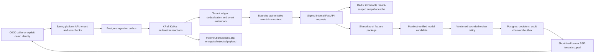
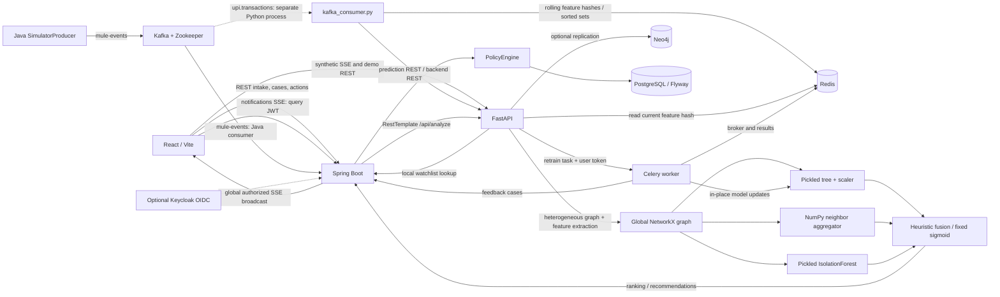

# Architecture

## Current Research Implementation

The current path below supersedes the baseline described later. It is verified
on small local integration fixtures, not certified for bank deployment or large
graphs. The replacement React investigator console uses the authenticated
platform contracts, memory-only credentials and scoped bearer SSE. Desktop
workflow acceptance passes in the latest local browser run; mobile login still
fails. Production OIDC browser login and full Compose acceptance remain unverified.

Entrypoints: backend ApiApplication with the platform profile, FastAPI
serving:create_app, scripts/reproduce.py for explicit experiments, and
model_registry.py for verified candidate selection. Model weights are mounted
read-only. A missing artifact, schema/hash mismatch or missing runtime dependency
does not trigger training. The simulator requires explicit opt-in.

Kafka partition keys include tenant and source account. Logical deduplication,
durable outbox publication and audit persistence are tested; this is not a claim
of global ordering or exactly-once external bank actions. Context is built from
the tenant ledger and cached as a complete bounded snapshot, not an unlimited
production adjacency service. An over-budget graph fails explicitly. Late events
behind the current tenant watermark are rejected rather than silently reordered.

The registry checks evaluated candidates and supports graph-tabular shadow,
canary, promotion and rollback. Neural multi-version rollout is rejected until
independent deadline workers exist. GNN failure falls back explicitly to graph
tabular; unavailable ML produces a degraded rules-only internal review state,
not a manufactured probability. SOFT_HOLD has bounded expiry and release/appeal;
it does not freeze a bank account or recover money.

Current APIs are rooted at /api/v1: transactions, decisions and decision actions,
notes, appeal, feedback/export, replay, policy, audit, health, str-draft,
stream-token and authenticated events. Demo login and /api/demo/seed require the
explicit demo profile; seeding also requires admin. Internal ML exposes signed
snapshot, score, readiness, metrics and contract operations. Refer to the actual
PlatformController, DecisionStream and contracts/ml-openapi.json for schemas.

Current persistence is the platform_* schema in the later Flyway migrations;
historical tables remain for non-destructive upgrades but the runtime role cannot
access them. Raw identifiers are tokenized at ingestion, sensitive retained
content is encrypted, and protected policy/audit records are immutable. External
audit-head witnessing, complete retention/erasure and production identity approval
remain unfinished. See PLATFORM_CONTRACT.md for precise limitations.

### Current Measurement Boundary

Single-row model-only steady/burst percentiles are generated in
[reports/latency.json](../reports/latency.json) and rendered into the README.
Those model-only timings exclude feature/context access, HTTP, Kafka, policy and
SSE. The current measured network boundaries are rendered below when a successful
benchmark report exists. Unmeasured component stages remain explicitly empty;
total-path percentiles cannot be decomposed into per-stage percentiles. Neither
integration-test duration nor batch duration is a substitute. No target budget or
production SLO is asserted. The baseline table later in this document is historical.

Backend timers cover snapshot HTTP, score HTTP and Kafka processing with bounded
stage/outcome labels. Framework histogram bucket boundaries add their fixed le
label. Prometheus access is authenticated and role-gated. Structured stage logs
include scoped correlation IDs without transaction bodies or credentials; these
are not yet complete cross-service OpenTelemetry traces. Live collector/dashboard
deployment remains pending. Histogram availability does not establish measured
component percentiles in the table.

The ML service now holds bounded, expiring per-tenant/model/reference observation
windows. A required manifest-verified TRAIN-only reference anchors feature and
score PSI/KS signals. Metrics scope is signed and tenant-filtered; global process
operational counters are separate from private drift statistics. Missing baseline
artifacts fail startup rather than learning from incoming traffic. Insufficient
windows expose readiness, not fabricated zero drift. This adds local monitoring
signals, not a deployed collector or automatic retraining/promotion pipeline.

<!-- ARCH_LATENCY:START -->
| Boundary | Steady p50 / p95 / p99 (ms) | Burst p50 / p95 / p99 (ms) | Target budget |
|---|---|---|---|
| Graph-tabular model-only | 0.8599 / 1.2082 / 1.3811 | 6.0206 / 10.1323 / 17.3515 | Not set |
| ML HTTP | 30.5563 [29.9478, 31.3182] / 36.2333 [34.0417, 38.6967] / 38.9715 [36.2267, 39.0402] | 210.5032 [200.8717, 218.2892] / 402.7572 [283.2599, 412.0782] / 418.7650 [384.8617, 421.1970] | Not set |
| Kafka producer-to-SSE | 499.9703 [499.7349, 500.2143] / 503.9326 [502.0501, 525.7005] / 750.3070 [503.9538, 752.9088] | 1141.9945 [1016.4361, 1266.7175] / 1275.9435 [1273.5476, 1520.8901] / 1524.0605 [1278.3325, 1525.1855] | Not set |
| Kafka queue alone | Not measured | Not measured | Not set |
| Feature fetch alone | Not measured | Not measured | Not set |
| GNN path | Not measured | Not measured | Not set |
| Policy/persistence alone | Not measured | Not measured | Not set |
| SSE delivery alone | Not measured | Not measured | Not set |
<!-- ARCH_LATENCY:END -->

## Observed Baseline: Historical Audit

Baseline: `85b10e6e5df87f6ce7f44bb2ea6e12e66d65cf8a`. This diagram describes
existing code, not an assertion of successful deployment or production readiness.

## Modules and Entrypoints

| Module | Entrypoint | State / observations |
|---|---|---|
| Backend | `backend/.../ApiApplication.java`, Maven / Spring Boot | Intake, cases, actions, thresholds, SSE, local auth or optional OIDC |
| ML | `ml_service/main.py`, Uvicorn | Imports stateful graph, lazily loads unsafe legacy models; token presence is not validation |
| Graph | `graph_builder.py`, `graph_analytics.py`, `recovery_engine.py` | Global DiGraph and transaction list, optional Neo4j, no bounded adjacency retrieval |
| Python stream worker | `ml_service/kafka_consumer.py` | Separate process; subscribes to upi.transactions, unlike Java consumer |
| Retraining worker | `celery -A celery_app.celery worker` | Redis broker/result store; user-token forwarding; active model mutation |
| Training | `training/train_and_test.py`, `train.py`, notebook | Divergent synthetic/data and feature paths; random heldout split |
| Evaluation | `training/generate_metrics.py`, `external_benchmark.py`, `metrics_evaluator.py` | Different data/protocols; no single manifest-backed evaluation command |
| Frontend | `frontend/src/main.jsx`, `App.jsx` | Local token storage; Common.jsx configures backend/ML origins separately |
| Orchestration | `docker-compose.yml`, `run_all.bat`, `render.yaml` | Postgres, Redis, Zookeeper/Kafka, Neo4j, Keycloak, backend, ML, Celery, frontend |
| Existing CI | `.github/workflows/python-package-conda.yml` | Conda dependency ranges, flake8 and broad pytest only |

## HTTP and SSE Inventory

Spring controller prefixes and method mappings are authoritative, not README:

- `/api/auth/login`; `/api/health`, `/api/readiness`.
- `POST /api/intake`, `POST /api/prediction`, `POST /api/demo/seed`.
- `/api/cases`: list/detail, `/{caseId}/actions`, `/{caseId}/status`,
  `/{caseId}/assign`, `/{caseId}/comments`, `/feedback`, `/export/csv`,
  `/stats/summary`, `/policy/thresholds` (the latter are under cases).
- `/api/external/watchlist`, `/watchlist/all`, `/watchlist/add`, `/watchlist/remove/{id}`.
- `/api/audit-logs`, `/api/audit-logs/export/csv`, `/api/users`, `/api/users/{username}/status`.
- Spring SSE: `/api/notifications/subscribe` and `/api/stream/subscribe`; controller
  role guards exist but subscriber storage has no tenant/assignment scope.
- ML: `/`, `/api/health`, `/api/models`, `/api/analyze`, `/api/predict`,
  `/api/batch-predict`, `/api/external-check`, `/api/graph/query`,
  `/api/governance/retrain`, `/api/stream/next`, `/api/stream/subscribe`.
- ML demos: `/api/v1/detect`, `/api/v1/detect/advanced`, `/api/v1/metrics`,
  `/api/v1/audit/{run_id}`, `/api/v1/failure-demo`. These generate graphs rather
  than evaluate persisted real decisions. The advanced ensemble omits graph edges.

## Persistence and Model Loads

Flyway migrations under `backend/src/main/resources/db/migration/` are the running
schema authority; `database/schema.sql` is a separate, drifting schema document.
Tables include accounts, transactions, devices, locations, predictions, alerts,
cases, investigators, audit_logs, threat_intelligence, policy_configurations,
case_comments, complaints and investigator_actions. The initial transaction
schema has NOT NULL sender/receiver foreign keys with ON DELETE SET NULL; deletion
semantics need integration coverage. Monetary types differ between the schema
document and Flyway. There is no tenant key, policy-version ledger, feedback
quality table, transactional outbox, audit hash chain or model manifest in the
observed migrations. Model response JSON is retained on cases.

`ml_models.py` loads `trained_models/fast_path_model.pkl`,
`fast_path_scaler.pkl`, `gnn_weights.pkl`, `isolation_forest.pkl`. Absent artifacts
trigger synthetic training; some load failures also retrain. They are not verified
against hashes or a feature schema. Training writes the same locations. The
offline GNN trainer is a different forward pass from the serving implementation.

`GLOBAL_GRAPH`, `GLOBAL_TXNS`, and complaint uplifts live in a Python process.
Graph edges overwrite repeated sender/receiver pairs. Redis stores rolling
aggregates, not the specified bounded, versioned adjacency cache. Neo4j replication
is best effort, not the authoritative serving source. Multiple Uvicorn workers
would not share Python state or the in-memory AUDIT_RUNS map.

## Latency Budget and Measurement Status

No timings have been measured under the required protocol. A dash is deliberately
not zero. Budgets/SLOs will be decided after baseline measurements; legacy batch
duration divided by rows is not a request-latency measurement.

| Stage | Target Budget | Single-Row p50 | p95 | p99 | Steady/Burst Evidence |
|---|---|---|---|---|---|
| Kafka queue / consume | Not set | - | - | - | Not measured |
| Feature / adjacency fetch | Not set | - | - | - | Not measured |
| Fast-path model | Not set | - | - | - | Not measured |
| Deep-path graph / inference | Not set | - | - | - | Not measured |
| Fusion / policy / persistence | Not set | - | - | - | Not measured |
| SSE delivery | Not set | - | - | - | Not measured |
| ML HTTP | Not set | - | - | - | Not measured |
| Kafka-to-SSE total | Not set | - | - | - | Not measured |
